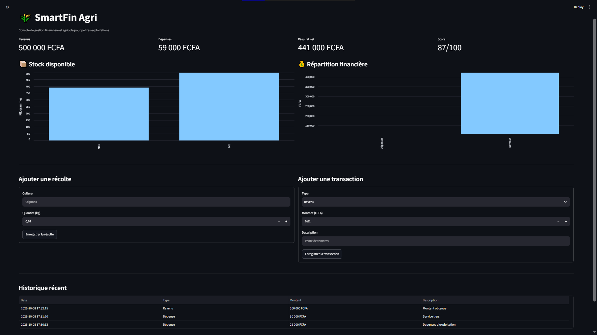

# 🌾 SmartFin Agri - Agricultural Management & Micro-Scoring MVP



> SmartFin Agri est un MVP en construction depuis Ziguinchor, au Sénégal,
> destiné à rendre le suivi des stocks et des finances agricoles plus simple,
> local et compréhensible.

## 📌 À propos du projet

Développé par **Adama SANE** (Développeur Python & Data Analyst autodidacte).

**SmartFin Agri** est un Minimum Viable Product (MVP) conçu pour répondre à un défi majeur de l'agriculture au Sénégal et en Afrique : **le suivi financier et l'accès au micro-crédit pour les exploitants agricoles.**

Ce projet a débuté comme un outil de gestion d'inventaire en ligne de commande
et propose aujourd'hui un dashboard web Streamlit local. Il permet de gérer les
stocks et les flux de trésorerie avec SQLite, puis de calculer un **Score de
Crédibilité** indicatif à partir des données enregistrées.

## 🚀 Fonctionnalités Clés

- **📦 Gestion des Stocks :** Enregistrement des récoltes avec mise à jour dynamique des quantités.
- **💰 Suivi Financier :** Historisation des transactions (Revenus issus des ventes, Dépenses en intrants/salaires).
- **📊 Dashboard :** Dashboard web Streamlit avec indicateurs financiers, graphique des stocks et historique des transactions.
- **🎯 Micro-Scoring (Credit Score) :** Algorithme transparent évaluant la rentabilité et le niveau d'activité pour générer un score indicatif sur 100. Ce score est une aide à la décision et ne remplace pas une décision de crédit.
- **💾 Persistance fiable :** Base SQLite locale, données conservées après redémarrage et validation des montants/quantités.
- **🧪 Tests automatisés :** Tests unitaires sans dépendance externe pour la persistance, les calculs et les validations.

## 🛠️ Stack Technique

- **Backend & Logique Métier :** Python 3
- **Base de données :** SQLite (Persistance des données)
- **Visualisation :** Graphiques natifs Streamlit
- **Interface :** Console Python et dashboard web Streamlit.

## 💻 Installation et Utilisation en local

1. Cloner le dépôt :

```bash
git clone https://github.com/AdamaSANE/SmartFin-Console-Agricultural-Management-System.git
cd SmartFin-Console-Agricultural-Management-System
```

2. Créer et activer l'environnement virtuel :

Sous Windows PowerShell :

```powershell
python -m venv .venv
.venv\Scripts\Activate.ps1
```

Sous macOS/Linux :

```bash
python3 -m venv .venv
source .venv/bin/activate
```

Après activation, le terminal doit afficher `(.venv)`. Toutes les commandes
Python et Streamlit ci-dessous utiliseront alors l'environnement isolé.

3. Installer les dépendances :

```bash
python -m pip install --upgrade pip
python -m pip install -r requirements.txt
```

4. Lancer l'application console :

```bash
python SmartFin_Console_Agricultural.py
```

Pour lancer le dashboard web :

```bash
streamlit run app.py
```

Le dashboard permet d'ajouter des récoltes, d'enregistrer des revenus ou
dépenses et de consulter les indicateurs depuis un navigateur. Il réutilise la
même base `smartfin.db` que la console.

La base `smartfin.db` est créée automatiquement. Pour utiliser un autre fichier :

```bash
python SmartFin_Console_Agricultural.py --database data/demo.db
```

5. Exécuter les tests :

```bash
python -m unittest discover -v
```

## 🌐 Déployer la landing page sur GitHub Pages

La landing page statique est composée de [index.html](./index.html) et
[css/styles.css](./css/styles.css). Un workflow GitHub Actions est inclus dans
`.github/workflows/pages.yml`.

Pour activer le déploiement :

1. Pousser le projet sur GitHub dans la branche `main`.
2. Ouvrir **Settings → Pages** dans le dépôt.
3. Choisir **GitHub Actions** comme source de déploiement.
4. Attendre la fin du workflow **Deploy landing page to GitHub Pages**.

La page publique sera disponible à l'adresse :

```text
https://adamasane.github.io/SmartFin-Console-Agricultural-Management-System/
```

Le dashboard Streamlit reste une application Python séparée : GitHub Pages
héberge la landing page statique, mais n'exécute pas `app.py`. Le bouton de
démo local est donc remplacé par les instructions de lancement et la
documentation.

Les montants sont exprimés en FCFA et les quantités en kilogrammes. Le score de
crédibilité est indicatif, explicable et doit être complété par des données
terrain avant toute décision de financement.

## ⚠️ Limites actuelles

- Les données sont stockées localement dans SQLite : il n'y a pas encore de
  comptes utilisateurs, d'authentification ou de synchronisation cloud.
- Le dashboard est conçu pour une démonstration et un usage local ; il n'est
  pas encore déployé comme service multi-utilisateur.
- Le score est un indicateur expérimental et ne constitue pas une décision de
  crédit.
